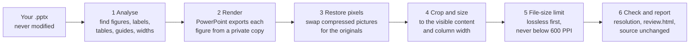

# Paper Figure Exporter

Turn the figures you drew in **PowerPoint** into **publication-ready PDFs**: one cropped,
correctly sized, vector PDF per figure, with your original picture pixels, in one double-click.

- **Vector stays vector.** Text, lines, shapes, charts and equations are exported by PowerPoint itself, not rasterised.
- **Original picture quality.** Embedded photos and plots are put back at their **original pixels**,
  not PowerPoint's compressed copy. Nothing is ever upscaled.
- **Automatic figure handling.** Each figure is found, cropped to its content and sized to your journal's
  full or half column width. Tables, captions and slide-edge guide lines are left out.
- **Consistent text size.** Half-width figures print text at the same size as full-width ones.
- **File-size limit without JPEG.** Large figures are shrunk losslessly first, and pictures are
  never pushed below your resolution target (600 PPI by default).
- **Safe.** Your PowerPoint file is never modified, and existing results are never overwritten.
  Anything uncertain is held for review instead of guessed.
- **Private.** Figures and reports carry no folder paths, user names, document authors, or photo
  metadata (EXIF camera, date or GPS), and no hyperlinks.

> Windows + desktop Microsoft PowerPoint required for exporting (see [Compatibility](#compatibility)).

---

## Contents

1. [Quick start](#quick-start)
2. [Compatibility](#compatibility)
3. [Preparing your slides](#preparing-your-slides)
4. [What you get](#what-you-get)
5. [How it works](#how-it-works)
6. [When something needs review](#when-something-needs-review)
7. [Settings](#settings)
8. [Command line](#command-line)
9. [Limitations](#limitations)
10. [Troubleshooting](#troubleshooting)
11. [Safety and privacy](#safety-and-privacy)
12. [Development and tests](#development-and-tests)
13. [License](#license)

---

## Quick start

1. **Download** this repository (*Code → Download ZIP*) and unzip it anywhere, e.g. your Documents folder.
2. **Save** your deck in PowerPoint (unsaved edits are not seen).
3. **Double-click `Export Figures.bat`** and choose your `.pptx`.
   Or drag one or more `.pptx` files onto `Export Figures.bat`.
4. When it finishes, `review.html` and the results folder open automatically. Results are written
   next to your deck in a new folder: `<deck name>_figures_<date>_<time>`.

**First run only (a few minutes):** the launcher checks your computer and sets itself up:

| Check | If missing |
|---|---|
| Windows, PowerShell | Required (built into Windows 10/11) |
| Microsoft PowerPoint (desktop) | Cannot be installed automatically. Without it, only the analysis report is produced |
| Python 3.10+ | Offers to install Python 3.12 for your user account (via `winget`, or the official python.org installer after verifying its digital signature). **No administrator rights needed** |
| Python packages | Installed automatically into a private environment in `%LOCALAPPDATA%\PaperFigureExporter` (nothing is installed into the tool folder or system-wide) |

Later runs start in seconds. To check or repair the setup without exporting, double-click **`Check Setup.bat`**.

---

## Compatibility

| Component | Supported | Notes |
|---|---|---|
| **Operating system** | Windows 11 (tested) and Windows 10 (expected to work), 64-bit | Export drives PowerPoint through Windows automation (COM). Windows on ARM: untested |
| **PowerPoint** | Desktop PowerPoint for Windows, version 16 (Microsoft 365; Office 2016/2019/2021/2024 use the same automation interface but are untested) | **Not** supported: PowerPoint for Mac, PowerPoint on the web, Google Slides, Keynote, LibreOffice. Their decks work if opened and saved as `.pptx` in desktop PowerPoint for Windows |
| **PowerShell** | Windows PowerShell 5.1 (built in) | PowerShell 7 can run the scripts too; 5.1 is the tested path |
| **Python** | 3.10 – 3.14 (64-bit preferred) | Installed automatically if missing (3.12). Developed with 3.11 (Windows) and 3.13 |
| **Python packages** | `python-pptx` ≥1.0.2,<2 · `pypdf` ≥5,<7 · `pypdfium2` ≥4.30,<6 · `Pillow` ≥10,<14 | Pinned to tested major versions in `engine/requirements.txt` |
| **Input files** | `.pptx`, `.pptm`, `.ppsx`, `.ppsm` | Legacy `.ppt` must first be saved as `.pptx` |
| **Caption languages** | English and Chinese | `Figure`/`Fig.`/`Table`, `图`/`表`; width hints in both languages |
| **Rights / network** | No admin rights. Internet only for the first-time setup | Works offline afterwards |
| **macOS / Linux** | Analysis only | `python engine/export_figures.py deck.pptx --analyze-only` works on any OS with Python, but exporting PDFs needs Windows PowerPoint |

Tested configuration: Windows 11 Pro, Windows PowerShell 5.1, Microsoft 365 PowerPoint (version 16),
Python 3.11. The automated test suite (56 tests) runs on Python 3.13.

---

## Preparing your slides

The tool works best with **one figure per slide**, laid out the way it should look in the paper.

**1. Put a label on each figure.** Add a *separate* text box starting with the figure number:

| Recognised label (case-insensitive) | Meaning |
|---|---|
| `Figure 3`, `Fig. 3`, `Fig 3`, `Figure S2`, `Figure IV`, `图 3` | A figure: exported |
| `Table 1`, `表 1` | A table: skipped |

The label text box is **left out of the PDF**, because captions go in your manuscript. Labels inside
a grouped drawing are treated as part of the drawing, not as labels.

**2. (Optional) state the width** in the label or in a separate short text box:
`full width`, `double column`, `two column`, `双栏`, `通栏`, or `half width`, `single column`,
`one column`, `单栏`, `半宽`. Without a hint, a figure less than 67% as wide as the widest figure
in the deck is half width.

**3. Several figures on one slide:** place their labels **side by side** (left/right). Each object
goes to the nearest label. Labels stacked vertically are ambiguous and are held for review.

**Handled automatically:**

- **Slide titles, footers, slide numbers and figure labels** are excluded.
- **Native tables** and slides labelled "Table" are skipped.
- **Text-only slides** are skipped; **hidden slides** are skipped unless enabled in settings.
- **Alignment guide lines** are removed. These are straight lines that touch no other object and
  sit outside the figure, or long horizontal/vertical lines that overshoot all other content at
  both ends.
- **Objects that stick out past the slide edge** are cut at the edge, exactly as PowerPoint
  shows the slide. These parts are usually transparent text-box or picture margins.
- **Unlabelled slides** are exported automatically only if they contain a native PowerPoint chart
  or an Origin graph object. Everything else unlabelled is held for review.

---

## What you get

| File | Contents |
|---|---|
| `Fig1.pdf`, `Fig2.pdf`, … | One page per figure, numbered in slide order (within a slide: top to bottom, then left to right). Cropped to the content plus 2 pt of white space |
| `Fig1.png`, … | Previews (600 DPI by default) |
| `review.html` | **Start here.** Every slide with numbered boxes around every object: what was exported, skipped or held, and why. Also shows each figure's size, text scale ("10 pt on the slide prints at 8.9 pt") and file size |
| `quality_report.html` | The real resolution (PPI) of every picture at its final printed size, which pictures were restored to original pixels, and how to fix low-resolution ones (Chinese/English) |
| `overrides.generated.json` | Editable record of all choices (see [review](#when-something-needs-review)) |
| `manifest.json`, `manifest.csv` | Machine-readable details |
| `lossless/` | Only if a figure had to be shrunk to meet the file-size limit: its untouched version |
| `rendered/` | Slide images (used by `review.html`) and the renderer log. PowerPoint's raw per-figure PDFs are removed after a successful run because they contain the deck's metadata (keep them with `--keep-intermediate`) |

**Sizes:** full-width figures are scaled to `full_width_mm` (default **165.1 mm** = 6.5 in, the text
width of US-letter paper with 1-inch margins; set your journal's value). Half-width figures get a page
exactly half that wide. Their content is drawn at the **same scale as the full-width figures** and
centred with white side margins, so text prints at the same size in every figure. Aspect ratios
are always preserved.

---

## How it works



1. **Analyse** (`export_figures.py`, using `python-pptx`). Reads every top-level object, including
   Office equations stored in compatibility wrappers, and groups objects into figures using the rules
   in [Preparing your slides](#preparing-your-slides). If a slide contains an object that can't be read
   reliably, its figure is held for review rather than risk silently losing something.
2. **Render** (`ppt_render.ps1`). Copies the deck to a private temporary folder and opens the
   **copy** in PowerPoint with macros disabled and no link updates. It saves an image of every slide,
   then for each figure hides all other objects and exports a print-quality PDF. Every object's
   position is checked before and after, and the run stops if PowerPoint shows an object the analysis
   didn't know about. PowerPoint itself is left running.
3. **Restore original pixels** (`preserve_images.py`). PowerPoint's PDF export recompresses pictures
   (typically ~200 PPI). Each picture in the PDF is matched to its source image in the `.pptx` by
   position, crop and appearance, then replaced with the **exact original pixels**, keeping
   PowerPoint's own clipping and drawing order. JPEGs are embedded byte for byte. A picture is only
   replaced when the match is unambiguous; otherwise PowerPoint's version is kept and reported.
   Special case: when PowerPoint's PDF has filled a picture's transparent areas (seen with
   transparent TIFF/PNG files), the slide image from step 2 decides. If the slide shows them
   transparent, the original transparency is restored.
4. **Crop and size.** Finds the visible content (at 216 DPI, for measurement only; the PDF stays
   vector), crops the PDF page to it, then scales it to the target width. Fonts and vector content
   are untouched.
5. **File-size limit** (`size_control.py`, only if a figure exceeds `max_file_mb`):
   a) re-store pictures with lossless PNG-style compression (identical pixels);
   b) if still too big, reduce only pictures sharper than the PPI target, to the highest resolution
   that fits (found by searching on real file sizes), never below the target.
   **No JPEG is ever written.** The untouched file goes to `lossless/`.
6. **Check and report** (`image_quality.py`, `quality_report.py`). Measures every picture's real
   PPI at its printed size, checks that the source file's fingerprint (SHA-256) is unchanged, and
   writes the reports.

---

## When something needs review

Held items appear in **orange** in `review.html`, and the window says *"some slides need your decision"*.
Common causes: no label on a slide with pictures or drawings, stacked labels, or an embedded Excel/Word object.

1. Open `review.html` and note the **object numbers** shown in the boxes on the slide.
2. Open `overrides.generated.json` (in the results folder) with Notepad. For each slide, edit its `groups`:
   ```json
   "4": { "groups": [
     { "kind": "figure", "shape_ids": [5, 7, 9, 12], "width": "half", "label": "Figure 4" },
     { "kind": "skip",   "shape_ids": [13] }
   ] }
   ```
   - `kind`: `figure`, `table`, `skip` or `review`.
   - `shape_ids`: the object numbers, or `"all_content"` for every visible object except labels and guides.
   - `width`: `full` or `half`.
   - Optional: `crop_pt`: `[left, top, right, bottom]` in slide points, for a manual crop.
   - Optional: `allow_offslide`: `true` keeps objects past the slide edge on an enlarged canvas.
   - A whole slide can be skipped with `"6": { "kind": "skip" }`.
3. Save it **next to your deck** as `<deck name>.figures.json` (e.g. `MyPaper.pptx` → `MyPaper.figures.json`).
4. Run `Export Figures.bat` again. The file is picked up automatically.

The file records the deck's fingerprint. If you edit and re-save the deck, object numbers can change,
so the old choices are **ignored with a warning**. Repeat the steps with the new `overrides.generated.json`.

---

## Settings

`settings.json` (next to `Export Figures.bat`) is optional; edit it with Notepad.

| Setting | Default | Meaning |
|---|---|---|
| `full_width_mm` | `165.1` | Final width of full-width figures (mm). Use your journal's value. `null` = keep each figure's size from the slide |
| `half_width_mm` | `null` | Width of half-width figures. `null` = half of `full_width_mm` |
| `half_width_text` | `"match_full"` | `"match_full"`: half-width figures use the full-width figures' scale (same text size), centred. `"fill"`: content fills the half width (text may come out larger) |
| `max_file_mb` | `10` | Maximum PDF size per figure, reached losslessly (see [How it works](#how-it-works)). `null` = no limit |
| `offslide_content` | `"clip"` | Objects past the slide edge: `"clip"` cuts at the edge as PowerPoint shows it; `"expand"` keeps them on an enlarged canvas; `"review"` holds the figure |
| `min_ppi` | `600` | Resolution target: pictures below it at final size are flagged in `quality_report.html`; size control never goes below it. Pictures are never upscaled |
| `preview_dpi` | `600` | Resolution of the PNG previews (does not affect the PDFs) |
| `include_hidden_slides` | `false` | Also export hidden slides |
| `strict_ppi` | `false` | Report the run as not OK (exit code 3) when a picture is below `min_ppi` |
| `open_results_when_done` | `true` | Open `review.html` and the results folder at the end |

Guide lines are always removed by the launcher. Use the command line option `--keep-guide-lines` to keep them.

---

## Command line

For scripting or other environments. The launcher defaults above differ from the engine defaults below,
which are deliberately conservative.

```powershell
# Windows, using the private environment created by the launcher:
powershell -NoProfile -ExecutionPolicy Bypass -File .\engine\Run-Export.ps1 -Source .\MyPaper.pptx -FullWidthMm 165.1 -MaxFileMb 10

# Any Python environment with engine/requirements.txt installed:
python engine/export_figures.py MyPaper.pptx --full-width-mm 165.1 --half-width-scale match-full \
       --offslide clip --max-file-mb 10
```

| Option | Default | Description |
|---|---|---|
| `--output DIR` | `<deck>_figures_<timestamp>` | New or empty output folder |
| `--config FILE` | – | Overrides JSON (see [review](#when-something-needs-review)) |
| `--analyze-only` | off | Inventory and `review.html` only; no PowerPoint (works on any OS) |
| `--full-width-mm`, `--half-width-mm` | keep source size; full/2 | Target widths |
| `--half-width-scale fill\|match-full` | `fill` | Half-width layout (launcher uses `match-full`) |
| `--half-threshold` | `0.67` | Width ratio below which a figure is half width |
| `--offslide review\|clip\|expand` | `review` | Objects past the slide edge (launcher uses `clip`) |
| `--keep-guide-lines` | off | Do not remove guide lines |
| `--max-file-mb` | none | File-size limit per figure |
| `--min-ppi` | `600` | Resolution target / floor |
| `--strict-ppi` | off | Exit code 3 when the target is not met |
| `--padding-pt` | `2` | White space around the content |
| `--trim-dpi` | `216` | Resolution used only to measure the crop |
| `--preview-dpi` | `600` | PNG preview resolution |
| `--include-hidden` | off | Include hidden slides |
| `--native-images` | off | Diagnostic: keep PowerPoint's compressed pictures |
| `--keep-intermediate` | off | Keep PowerPoint's raw PDFs in `rendered/` (they include the deck's author/title metadata) |
| `--timeout` | `600` | PowerPoint renderer timeout (seconds) |

**Exit codes:** `0` all figures exported · `2` some items need review (figures that could be exported still were) ·
`3` resolution target not met (`--strict-ppi`) · `1` error.

---

## Limitations

- **PowerPoint does the drawing.** What you get is what PowerPoint's PDF export produces, so fonts must
  be installed. Fonts whose licence forbids embedding may be rasterised. Animations and videos export
  as their static frame.
- **Embedded objects** (Excel, Origin, …) are exported from their saved preview image; they are never
  opened or recalculated. Unlabelled Excel/Word objects are held for review; with a figure label they are exported.
- **Pictures that cannot be restored** to original pixels keep PowerPoint's compressed copy (~200 PPI at
  slide size), with a note in the quality report. These are pictures with effects (shadow, glow,
  recolour, brightness/contrast), non-rectangular crops (e.g. oval), embedded colour profiles,
  colour-key transparency, tiling, EXIF rotation, or ambiguous matches.
  Tip: in PowerPoint, *File → Options → Advanced → Image Size and Quality*, tick
  *Do not compress images in file* and set *Default resolution* to *High fidelity*.
- **Resolution cannot be invented.** If a source picture has too few pixels for 600 PPI at its printed
  size, the report says how many pixels are needed or how small the figure would have to be. Re-export
  the plot at a higher resolution or as vector (PDF/EMF/SVG).
- **Detection is rule-based.** Labelled, one-figure-per-slide decks work automatically; anything else
  may need a 2-minute [review](#when-something-needs-review).
- **Saved file only.** Unsaved changes in an open PowerPoint window are not exported.

---

## Troubleshooting

| Symptom | What to do |
|---|---|
| "Python packages could not be set up" | The window shows which package failed and why. *Cannot reach pypi.org*: check the internet connection, VPN or firewall, or try another network. *DLL load failed*: install the [Microsoft Visual C++ Redistributable](https://aka.ms/vs/17/release/vc_redist.x64.exe) and restart. Full log: `%LOCALAPPDATA%\PaperFigureExporter\logs\pip.log` |
| Setup seems broken | Delete `%LOCALAPPDATA%\PaperFigureExporter\venv`, or run `"Check Setup.bat" -Repair` from a command prompt |
| "Scripts are disabled on this system" | Some managed PCs block PowerShell scripts by policy. Ask your IT department |
| "Microsoft PowerPoint was not found" | Install desktop PowerPoint for Windows. Until then only `review.html` (analysis) is produced |
| A figure is held for review | See [When something needs review](#when-something-needs-review) |
| Crop includes a stray line or empty space | A guide line was not recognised. Remove it from the slide, or exclude its object number in the overrides file |
| Saved choices "made for an older saved version" | The deck changed; redo the review with the new `overrides.generated.json` |
| Still over the file-size limit | `review.html` explains why: usually pictures already at the PPI floor. Options: raise `max_file_mb` if your journal allows it, lower `min_ppi`, or use smaller source pictures |
| Old `.ppt` file | Open it in PowerPoint and *Save As* `.pptx` |

The last run's log is at `%LOCALAPPDATA%\PaperFigureExporter\logs\last_run.log`.

---

## Safety and privacy

- **Your deck is never modified.** Only a private temporary copy is opened, and the deck's SHA-256
  fingerprint is verified before and after every run.
- **Nothing is overwritten.** Each run writes to a new folder, and the tool refuses to write into a
  non-empty one.
- **No macros, no link updates, no embedded objects activated.** PowerPoint is never closed by the tool.
- **Nothing is uploaded.** The internet is used only to install Python and its packages (from python.org,
  winget and PyPI).
- **The tool folder stays clean:** the Python environment and logs live in `%LOCALAPPDATA%\PaperFigureExporter`.
- **No personal information in the results:**
  - *Figure PDFs* contain only the figure. Document and page metadata (XMP, PowerPoint private data),
    hyperlinks and other annotations are removed. Embedded photos lose their EXIF/XMP/IPTC
    metadata and comments (camera, date, GPS location, author) without changing a single pixel;
    colour profiles are kept. The PDF's own metadata is just its title (`Fig1`) and the tool name.
  - *Reports and logs* record the deck by file name only. Any remaining folder path, for example in
    an error message, is shortened to `~`, `<deck folder>`, `<results>` or `<temp>`, so your user name
    and folder names do not appear.
  - *PowerPoint's raw exports*, which carry the deck's author and title, are deleted after a successful run.
- **What results do contain:** your figures, and in `review.html` and `manifest.json` images and text of
  the analysed slides (that is their purpose). Share the `Fig*.pdf` files; keep the rest for yourself.
  `.gitignore` keeps decks and result folders out of this repository.
- The full path of the results folder is shown in the window when a run finishes, and the local log
  (`%LOCALAPPDATA%\PaperFigureExporter\logs`) stays on your computer.

---

## Development and tests

```
paper-figure-exporter/
├── Export Figures.bat        # double-click entry point (drag-and-drop supported)
├── Check Setup.bat           # environment check / repair only
├── settings.json             # user settings
└── engine/
    ├── launcher.ps1          # self-check, auto-install, file picker, settings → CLI
    ├── Run-Export.ps1        # command-line wrapper
    ├── export_figures.py     # analysis, grouping, layout, crop, orchestration (CLI)
    ├── ppt_render.ps1        # PowerPoint automation (private copy, per-figure PDF export)
    ├── preserve_images.py    # original-pixel restoration, transparency check
    ├── pdf_images.py         # lossless PNG-predictor image encoding
    ├── size_control.py       # file-size limit (lossless + PPI-floored reduction)
    ├── privacy.py            # metadata/annotation/EXIF removal, path redaction
    ├── image_quality.py      # real-PPI measurement at final size
    ├── quality_report.py     # quality_report.html
    ├── check_env.py          # package self-check used by the launcher
    └── tests/                # unit tests, synthetic decks, manual test plan
```

Run the tests (no PowerPoint needed; one PowerShell test runs on Windows only):

```bash
pip install -r engine/requirements-test.txt
python -m unittest discover -s engine/tests
```

`engine/tests/TEST_PLAN.txt` describes the end-to-end check with PowerPoint using the synthetic decks
(`synthetic.pptx`, `highres_synthetic.pptx`; regenerate with `create_fixture.py` / `highres_fixture.py`).

Contributions are welcome. Please include a synthetic test case, never slides from an unpublished paper.

---

## License

[MIT](LICENSE) © 2026 LiuyangMechSE
